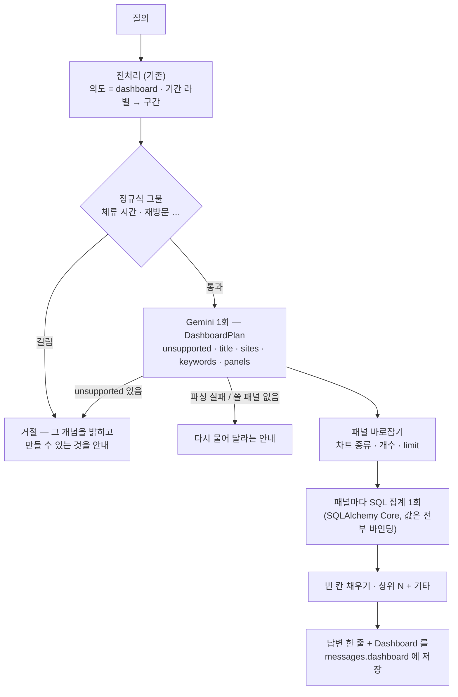

# 대시보드 — 질의를 시멘틱 레이어로 옮겨 집계하기

"이번 달 사이트별로 몇 개 봤어", "요일별 추이 그래프"처럼 기록을 하나하나 찾는 대신 **모아서
세는** 질의를 받으면, 채팅 말풍선 안에 대시보드(숫자 타일 + 차트 1~4개)를 그려 준다. 데이터에
없는 개념(체류 시간, 재방문 횟수, 주제 분류 등)을 물으면 비슷한 것으로 바꿔 그리지 않고 **만들 수
없다고 답한다.**

전체 질의 흐름에서의 위치는 [`query-flow.md`](query-flow.md)의 `dashboard` 갈래다.

| 역할 | 파일 |
| --- | --- |
| 레이어 정의(측정값·기준·조건) | `services/dashboard/semantic_layer.py` |
| 질의 → 대시보드 구성 (Gemini) | `services/dashboard/planner.py` |
| 구성 바로잡기 · SQL 실행 · 거절 | `services/dashboard/builder.py` |
| 구성·결과 스키마 | `schemas/dashboard.py` |
| 화면 | `frontend/src/components/dashboard/` |

## 흐름

**모델은 SQL 을 쓰지 않는다.** 레이어의 이름(enum)을 고를 뿐이고, 이름을 SQL 식으로 바꾸는 것은
서버다. 모델에게 SQL 을 쓰게 하면 없는 컬럼을 지어내거나 조용히 틀린 집계를 하는데, 결과가 숫자라
틀렸다는 것이 드러나지 않는다.

## 시멘틱 레이어

바탕은 `documents` 한 테이블이다. URL 하나가 문서 하나이고 `timestamp`는 그 URL 을 **처음**
수집한 시각이다. 그래서 "본 페이지 수"는 처음 본 페이지의 수이며, 같은 페이지를 다시 본 것은 세지
않는다(대시보드 아래 주석으로 늘 밝힌다).

| 측정값 | 식 | 더할 수 있나 | 빈 칸 |
| --- | --- | --- | --- |
| `page_count` 본 페이지 수 | `COUNT(id)` | 예 | 0 |
| `site_count` 사이트 수 | `COUNT(DISTINCT url_host(url))` | 아니오 | 0 |
| `avg_text_length` 평균 본문 길이 | `AVG(LENGTH(full_text))` | 아니오 | 비움 |

| 기준 | 성격 | 식(사용자 지역 시각 기준) |
| --- | --- | --- |
| `day` 날짜 | 시간축 | `date(local)` |
| `week` 주 | 시간축 | `date(local, '-6 days', 'weekday 1')` — 월요일 시작 |
| `month` 월 | 시간축 | `strftime('%Y-%m', local)` |
| `weekday` 요일 | 순환 | `(%w + 6) % 7` — 0이 월요일 |
| `hour` 시간대 | 순환 | `%H` |
| `site` 사이트 | 범주 | `url_host(url)` — `www.` 를 뗀 호스트 |

`local`은 `datetime(timestamp, '+540 minutes')`처럼 요청의 `client_now` 오프셋으로 옮긴 값이다.
UTC 그대로 자르면 한국에서는 아침 아홉 시 이전에 본 것이 전날로 세어진다. `url_host`는 SQLite 에
없는 함수라 파이썬 함수를 그 커넥션에 등록해 SQL 안에서 부른다.

| 조건 | 구성 필드 | SQL |
| --- | --- | --- |
| 기간 | 재작성의 `time_range` (대시보드가 따로 받지 않음) | `timestamp >= since AND < until` |
| 사이트 | `sites` | 호스트가 같거나 `.{site}` 로 끝남 — 하위 도메인 포함 |
| 키워드 | `keywords` | 제목이나 본문에 **하나라도** 들어감 (`LIKE`, 와일드카드 이스케이프) |

측정값이나 기준을 더하려면 `services/dashboard/semantic_layer.py`의 enum 과 정의 한 줄씩을 더하면 된다. 모델에게
보여 주는 설명(`catalog()`)과 거절할 때의 안내(`capabilities_summary()`)가 정의에서 만들어지므로
따로 고칠 곳이 없다.

## 거절

| 경우 | 판정하는 곳 | 답 |
| --- | --- | --- |
| 수집하지 않는 것이 분명한 개념 ("체류 시간", "머문 시간", "재방문", "다시 본 횟수") | 정규식 (`unsupported_by_rule`) — 모델을 부르지 않는다 | 그 개념을 밝혀 거절 + 만들 수 있는 것 |
| 그 밖에 레이어로 표현할 수 없는 조건 ("주제별", "클릭 수" …) | 모델이 `unsupported`에 담음 | 같음 |
| 구성 응답을 해석하지 못함 / 바로잡고 나니 쓸 패널이 없음 | 서버 | "무엇을 어떤 기준으로 볼지" 다시 물어 달라는 안내 |

거절은 **전부 아니면 전무**다. 만들 수 있는 부분만 그리지 않는다 — 사용자가 물은 것과 다른
차트가 나가면 그것을 물은 것으로 알고 읽는다.

`unsupported`를 스키마의 맨 앞 필드로 둔 것도 같은 이유다. 패널부터 채우게 하면 "체류 시간"을
본문 길이로 바꿔치는 식으로 어떻게든 채운 뒤 `unsupported`를 비워 둔다. 정규식 그물은 그래도
남는 바꿔치기를 막는 마지막 장치이고, 일부러 좁게 잡았다("체류 비자 관련 글 수"는 통과해야 한다).

## 패널 바로잡기 (`normalize_panels`)

무엇을 볼지는 맞게 골랐는데 그리는 방식만 어긋난 것은 거절하지 않고 고쳐 그린다.

| 모델이 고른 것 | 바뀌는 것 |
| --- | --- |
| 기준 없음 | `kpi` |
| 기준이 있는데 `kpi` | `bar` |
| 시간축이 아닌 기준(요일·시간대·사이트)에 `line` | `bar` — 선은 이어지는 시간을 뜻한다 |
| 더할 수 없는 측정값이나 시간축에 `pie` | `bar` |
| 사이트별 사이트 수 | 버림 (모든 칸이 1) |
| 같은 (측정값, 기준) 중복 | 버림 |
| 5개 이상 | 앞 4개 |
| 사이트 기준 `limit` | 없으면 10, 최대 20 |

## 결과를 만드는 규칙

- **시간축은 빈 칸을 채운다.** 기간이 있으면 그 기간 전체를 칸으로 깐다("이번 달 일별"에서 아직
  안 본 초순도 0으로 보인다). 기간이 없거나 366칸을 넘으면 기록이 있는 범위로 좁히고, 그래도 넘으면
  최근 366칸만 남기고 주석을 단다. 평균처럼 빈 칸이 0이 아닌 측정값은 그 칸을 비운다.
- **순환 기준은 모든 칸을 순서대로** (월~일, 0~23시).
- **사이트는 값이 큰 순서로 `limit`개**, 같은 값은 이름순(다시 열어도 순서가 같도록). 나머지는
  더할 수 있는 측정값일 때만 `기타` 한 칸으로 묶는다.
- 답변 문장은 Gemini 없이 만든다. 조건에 맞는 페이지가 0건이면 "그 기간에는 조건에 맞는 기록이
  없다"고 밝힌다 — 0으로 채운 차트만 덩그러니 나가면 아예 기록이 없는 줄로 안다.

## 저장과 이어 묻기

대시보드는 `messages.dashboard`(JSON)에 **데이터째** 저장한다. 결과 카드처럼 id 만 남겨 다시
실행하지 않는 것은, 그사이 기록이 쌓이면 "이번 주" 대시보드의 숫자가 그때 보여준 것과 달라지기
때문이다. `GET /conversations/{id}`가 이 값을 그대로 돌려줘 다시 연 대화에도 같은 차트가 그려진다.

"그거 주별로 바꿔줘"처럼 앞선 대시보드를 고치는 요청은 두 군데서 풀린다.

- 재작성 호출이 이것을 `dashboard`로 판정하고, 기간을 새로 말하지 않았으면 앞선 대시보드의 기간을
  `time_range`로 다시 담는다(답변 문장에 기간이 적혀 있다).
- 구성 호출에는 가장 최근 대시보드의 구성(제목·기간·조건·패널)이 별개 발화로 실린다.

대시보드 턴은 결과 카드를 보여주지 않으므로 `result_document_ids`가 `NULL`이다. 앞서 찾아준
목록은 그대로 지목 후보로 남는다.

## 화면

`MessageBubble`이 `dashboard`가 있는 말풍선을 넓혀 `DashboardView`를 그린다. 차트 라이브러리 없이
SVG·div 로 그린다.

| `chart` | 그리는 것 |
| --- | --- |
| `kpi` | 숫자 타일 — 위에 한 줄로 모은다 |
| `bar` | 사이트 기준이면 가로 막대(이름이 길다), 그 외는 세로 막대 |
| `line` | 2px 선 + 옅은 면, 끝점에만 값, 호버 시 십자선 + 툴팁 |
| `pie` | 도넛 + 이름·값·몫을 적은 범례. 범주 색은 7개까지, 나머지는 `기타`(회색) |
| `table` | 표 |

모든 차트 패널에 **표로 보기** 토글이 있고, 화면 낭독기에는 차트 대신 표가 읽힌다. 색은
`globals.css`의 `--viz-*` 토큰만 쓰며 다크 모드 값은 따로 골라 두었다.

## 알려진 한계

- **기간은 대시보드 전체에 하나다.** "이번 달과 지난달 비교"처럼 패널마다 다른 기간은 표현하지
  못한다.
- **키워드는 낱말이 들어갔는지만 본다.** 주제 분류가 아니라서 "리액트"가 지나가듯 언급된 글도 센다.
  여러 낱말은 OR 다.
- **'처음 본 때'만 안다.** 재방문은 세지 않는다([query-flow.md](query-flow.md)의 알려진 한계와 같은 뿌리).
- **오프셋은 요청 시각의 것 하나다.** 서머타임이 있는 지역에서는 경계를 넘은 기록이 한 시간 어긋난다.
- **패널 제목은 모델이 짓는다.** 이어 묻기로 기간이 바뀌어도 앞선 제목("8월 총 …")을 그대로 쓰는
  경우가 있다. 실제 기간은 제목 아래 조건 칩이 정확하다.
